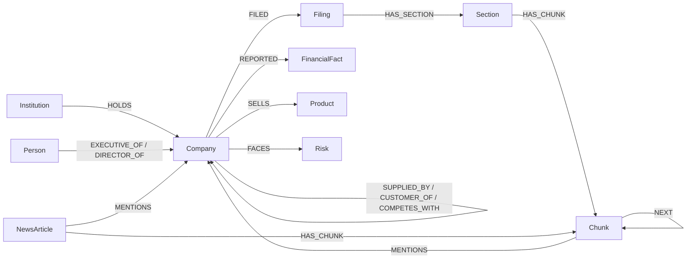

# Graph schema

Constraints and indexes are created by `src/company_intel/schema.py` (`make schema`).

## Nodes

| Label | Key | Other properties | Phase |
|---|---|---|---|
| `Company` | `cik` | `ticker`, `name`, `sector` | 1 |
| `Filing` | `accession` | `form`, `filed_date`, `fiscal_year`, `url` | 1 |
| `Section` | `id` (`accession:item`) | `item`, `title` | 1 |
| `Chunk` | `id` (`section_id:position`) | `text`, `embedding`, `embedding_model`, `position` | 1 |
| `FinancialFact` | `id` | `concept`, `value`, `unit`, `period_end`, `fiscal_year` | 2 |
| `Institution` | `cik` | `name` | 2 |
| `Person` | `id` | `name`, `aliases` | 3 |
| `Product` | `id` | `name`, `category` | 3 |
| `Risk` | `id` | `name`, `category` (supply chain, regulatory, geopolitical...) | 3 |
| `NewsArticle` | `url` | `title`, `published_at`, `source` | 4 |

## Relationships

| Relationship | Properties | Source | Phase |
|---|---|---|---|
| `(Company)-[:FILED]->(Filing)` | | EDGAR | 1 |
| `(Filing)-[:HAS_SECTION]->(Section)` | | parsing | 1 |
| `(Section)-[:HAS_CHUNK]->(Chunk)` | | chunking | 1 |
| `(Chunk)-[:NEXT]->(Chunk)` | | chunking | 1 |
| `(Company)-[:REPORTED]->(FinancialFact)` | | XBRL | 2 |
| `(Institution)-[:HOLDS]->(Company)` | `shares`, `value_usd`, `quarter` | 13F | 2 |
| `(Company)-[:SUPPLIED_BY\|CUSTOMER_OF\|COMPETES_WITH]->(Company)` | `source_chunk` | LLM extraction | 3 |
| `(Person)-[:EXECUTIVE_OF\|DIRECTOR_OF]->(Company)` | `role`, `source_chunk` | LLM extraction | 3 |
| `(Company)-[:SELLS]->(Product)` | `source_chunk` | LLM extraction | 3 |
| `(Company)-[:FACES]->(Risk)` | `source_chunk` | LLM extraction | 3 |
| `(Chunk)-[:MENTIONS]->(Company\|Person\|Product\|Risk)` | | LLM extraction | 3 |
| `(NewsArticle)-[:MENTIONS]->(Company)` | | news ingest | 4 |

Every extracted relationship carries `source_chunk`, so a graph answer can always cite
the text it came from.

## Indexes

- `chunk_embedding`: vector index on `Chunk.embedding` (cosine, dimensions from `EMBEDDING_DIMENSIONS`)
- `chunk_text`: full-text index on `Chunk.text`
- `entity_names`: full-text index on `name` across Company, Person, Institution, Product, Risk (entity linking)
- Uniqueness constraints on every key above, and range indexes on `Company.ticker`,
  `Filing.fiscal_year`, `Section.item`, `NewsArticle.published_at`, `FinancialFact.concept`
